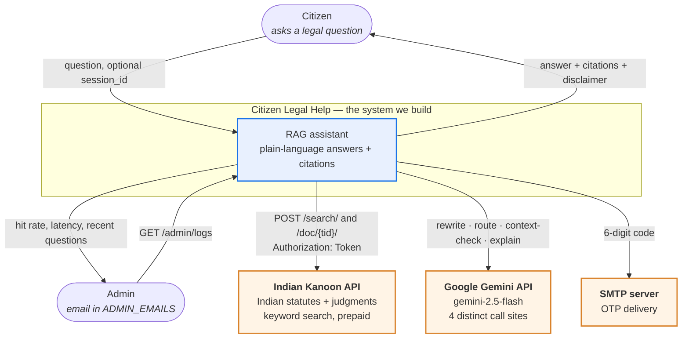
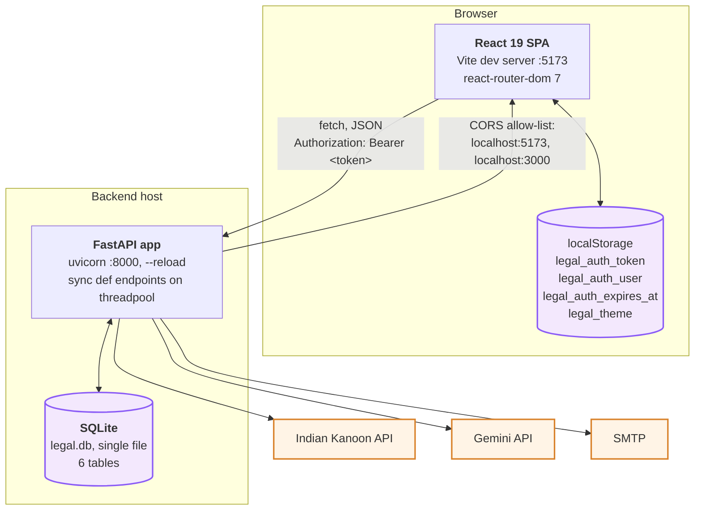
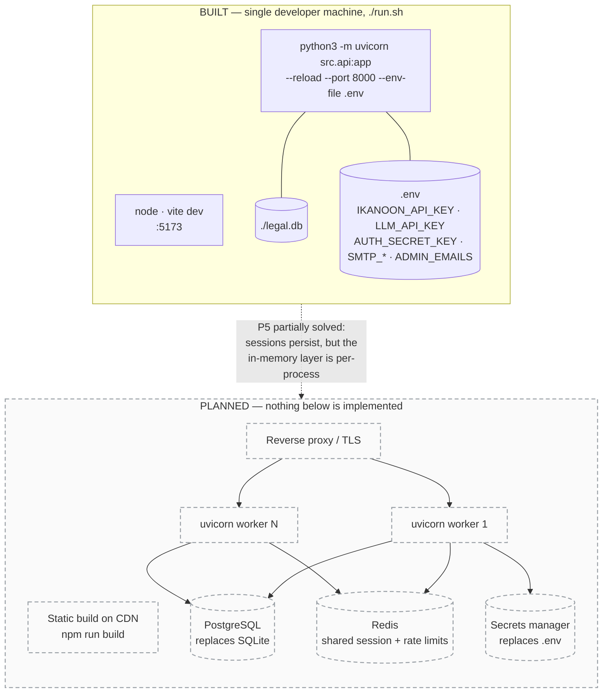

# 01 — High-Level Design

Context, containers, deployment. Read [README.md](README.md) first for the one
fact and the problem IDs (P1–P10) these diagrams reference.

---

## §1 Context — who uses it, what we don't own

Three external dependencies, and the design is shaped by what each one charges
or refuses to do.

**Why it looks like this**

- **Indian Kanoon is the product, not a convenience.** No legal knowledge is
  fine-tuned into the model. All Indian-law specialisation lives in retrieval, so
  the law stays current as BNS/BNSS/BSA are amended, and the LLM vendor stays
  swappable ([p.md](../p.md) §1). The cost of that choice is **P1** — their search
  is keyword-only — and **P7**, because every repeat question re-bills.
- **Gemini is called four times for different jobs**, not once. Rewriting,
  routing and the context-check are cheap single-token classifications; only the
  final explanation is a real generation. Splitting them is what lets three of the
  four run with `thinking_budget=0` and 10–64 output tokens.
- **SMTP, not an auth vendor** (**P6**). With no passwords there is nothing to
  reset, so email delivery is the entire identity stack. It degrades to a console
  log when unconfigured, which is what makes local dev possible with no
  credentials.

⚠ Both API keys are server-side only, and nothing in `frontend/` reads them
([p.md](../p.md) §6 "The Golden Rule"). That is the one security invariant these
diagrams should be checked against.

---

## §2 Containers — what processes run

**Why it looks like this**

- **SQLite, one file, six tables.** Zero-ops and transactional, which is the
  right trade for a prototype: `init_db()` runs on module import, so there is no
  migration step to forget. It is also the ceiling — see §3.
- **Endpoints are `def`, not `async def`.** Every outbound call in the codebase is
  blocking (`requests`, the Gemini SDK, `sqlite3`). FastAPI runs sync handlers in a
  threadpool, so blocking there does not stall the event loop. Declaring them
  `async` while still calling `requests` would be strictly worse.
- **Token in `localStorage`, not a cookie.** Chosen so the SPA can attach
  `Authorization` headers from plain `fetch` with no CSRF machinery.
  ⚠ The cost is XSS exposure; an `httpOnly` cookie is the safer end state.

---

## §3 Deployment — today, and what production needs

Solid = built and runnable via `./run.sh`. Dashed = `PLANNED`, nothing in the
repo implements it.

**Why the planned column exists**

Three things in the built column break the moment there is more than one worker
process, and a diagram that omitted them would read as "this is deployable":

1. **`SessionStore._memory_sessions` is a per-process dict.** Two workers serving
   the same user hold divergent copies of `last_context_text`, so a follow-up can
   silently lose its context. SQLite is the record (**P5**), but the cache in front
   of it is not shared — hence Redis.
2. **SQLite allows one writer.** Every `db.py` helper opens a fresh connection with
   a 10 s busy timeout; under concurrent writes that becomes lock contention.
   [p.md](../p.md) §2 always specified Postgres — SQLite is the deliberate
   prototype shortcut, not the intended design.
3. **`AUTH_SECRET_KEY` falls back to a random ephemeral key** with a logged
   warning ([auth.py](../src/auth.py)). Every restart invalidates every token, and
   two workers would sign with different keys — so tokens minted by one would be
   rejected by the other.

⚠ Also absent from both columns, because it is missing rather than deferred: any
**rate limit** on `/auth/send-otp` or `/auth/verify-otp`. A 6-digit code with a
10-minute window and unlimited attempts is brute-forceable. See
[05-state-machines.md](05-state-machines.md) §1.
