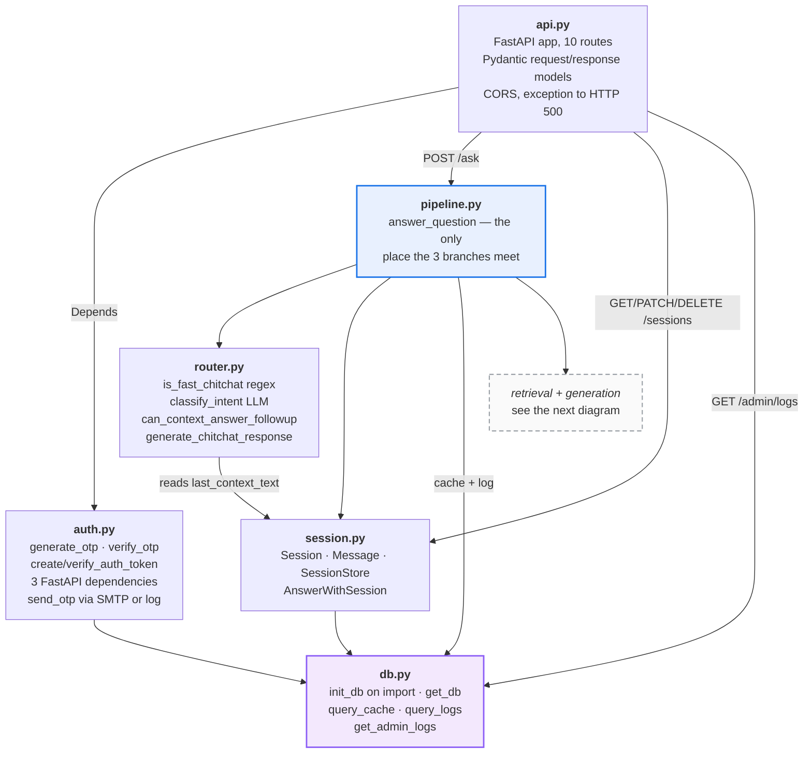
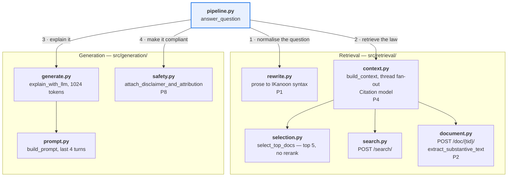
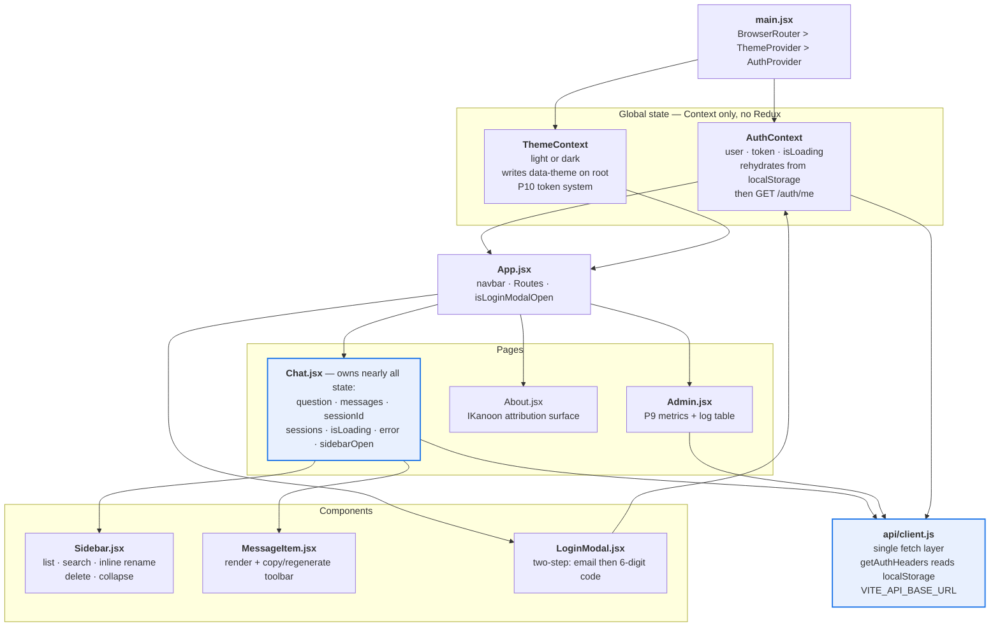
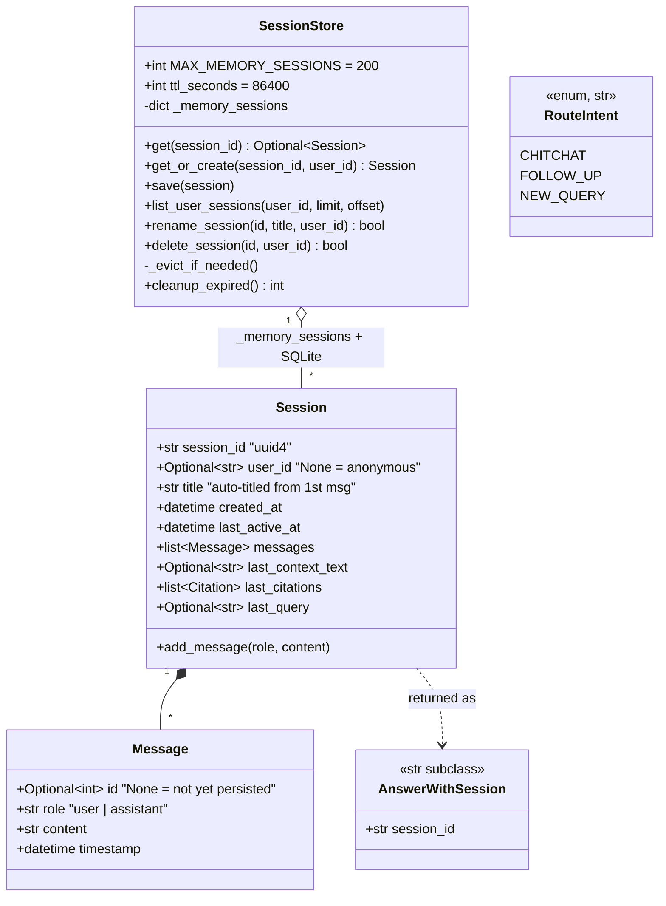
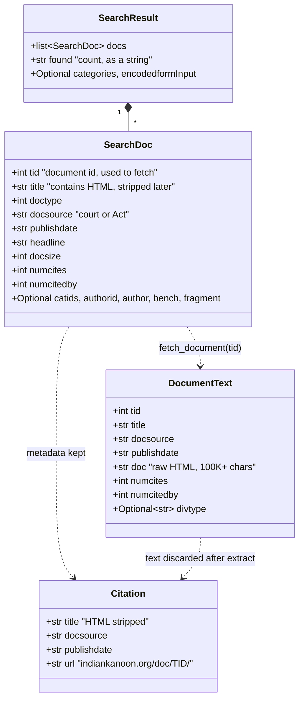
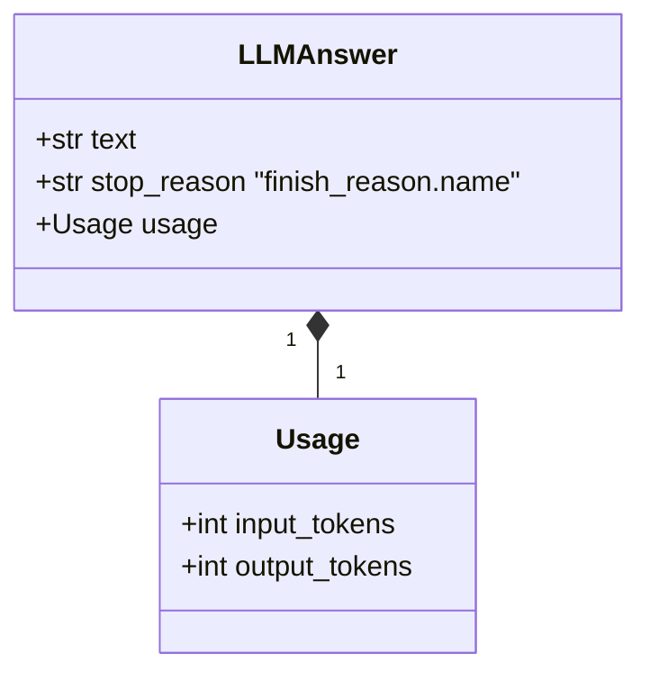

# 02 — Low-Level Design

Components per service, then the classes that actually carry the design. See
[README.md](README.md) for problem IDs (P1–P10).

---

## §1 Backend components — who owns what

One box per module in `src/`. Arrows are real imports.

### §1a Edge and orchestration

### §1b The RAG subsystems

Numbered edges are `answer_question`'s call order on the full-cost path.

**Why it is split this way**

- **`pipeline.py` is the only module that knows all three branches exist.**
  `router.py` classifies but never retrieves; `context.py` retrieves but never
  decides. That is what makes the cost story auditable: one function, one place
  where "did this request cost money?" is decided (**P3**).
- **`selection.py` is six lines and still its own module.** It is the designated
  seam for reranking by court tier or recency. `scripts/test_ranking_comparison.py`
  exists, so the experiment was run; the shipped behaviour is raw rank order.
  ⚠ Verify what that script concluded before claiming the no-rerank choice was
  measured.
- **`safety.py` sits after `generate.py`, never inside it** (**P8**). Attribution
  is a licence condition, so it cannot depend on the model complying.
- **`db.py` calls `init_db()` at import time.** Convenient — no migration step —
  but it means importing anything transitively creates `legal.db`. Tests work
  around this via `DATABASE_PATH`.
- ⚠ **`db.py` helpers ignore `db_path`.** `get_cached_query`, `cache_query`,
  `log_query` and `get_admin_logs` all call `get_db()` with no argument, so they
  always hit the module-level `DB_PATH`. `SessionStore` and `auth` accept an
  injected path; the cache and log layer does not.

---

## §2 Frontend components — who owns what state

**Why it is split this way**

- **Context, no state library.** Only two things are genuinely global — who you
  are and which theme — and both are read-mostly. Everything else is one page's
  concern, so `Chat.jsx` holds it locally.
- **`client.js` is the only module that calls `fetch`.** `getAuthHeaders()` reads
  the token from `localStorage` on every call rather than taking it from
  `AuthContext`, which is why a stale React state can never send a stale header.
- ⚠ **`Sidebar`, `Chat` and `AuthContext` all read `localStorage` directly** in
  places, so the storage keys are a fourth implicit contract alongside the three
  Context values.
- `Admin.jsx` is routed but **not route-guarded**: `App.jsx` shows the link when
  `isLoggedIn`, and authorisation is enforced server-side by `get_admin_user`.
  A non-admin can navigate to `/admin` and will see the 403 error text.

---

## §3 Classes — the objects that carry the design

Three clusters: conversation state, retrieval shapes, generation shapes.

**Why these shapes**

- **`Message.id` is `Optional[int]` and that is load-bearing.** `SessionStore.save`
  inserts only messages where `id is None`, then back-fills `lastrowid`. That is
  the whole append-only persistence strategy — no diffing, no full rewrite.
- **`AnswerWithSession` subclasses `str`.** `answer_question` must return both the
  answer and the session id, but older call sites and tests treat the result as a
  plain string. Subclassing `str` carries the id without breaking them.
  ⚠ It is a compatibility shim, not a design goal: `api.py` still reaches for it
  with `getattr(result, "session_id", ...)` and a `uuid4()` fallback, and
  `return_session=True` returns a plain tuple instead — three return shapes from
  one function.
- **`RouteIntent` subclasses `str`** so `intent.name` logs cleanly into
  `query_logs.intent` (**P9**) without a conversion layer.
- **`last_context_text` lives on the session, not in a cache.** That single field
  is what makes a `FOLLOW_UP` cost ₹0 in IKanoon fees (**P3**).

**Why these shapes**

- **Every optional field on `SearchDoc` is optional because IKanoon omits it**
  sometimes. Pydantic validates the response, so a shape change fails loudly at
  the boundary instead of as a `KeyError` deep in `build_context`.
- **`Citation` is deliberately tiny.** Four fields, all safe to show a citizen.
  `tid`, `doctype` and `catids` stay internal ([p.md](../p.md) §5). It is the only
  retrieval object that survives into the session and the cache, which is why it
  is the only one needing `model_dump()` round-tripping through JSON.
- **`DocumentText.doc` is the 100K-char problem (P2).** It is consumed by
  `extract_substantive_text` and then dropped — it is never stored, and never the
  thing put in the prompt.

⚠ **`Usage` is captured and then thrown away.** `explain_with_llm` populates
token counts, but `pipeline.py` reads only `answer.text`, and `query_logs` has no
token columns. The most direct cost signal the system collects never reaches the
admin dashboard (**P9**) — the obvious next fix.
