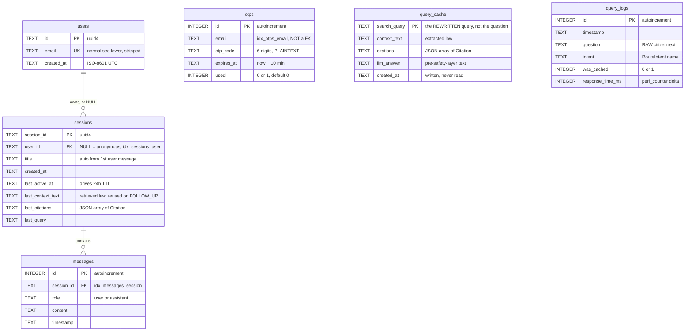
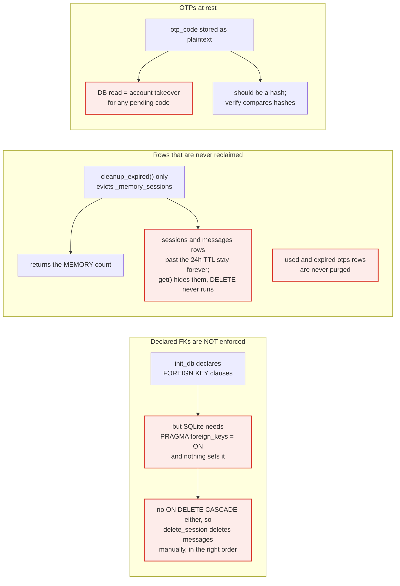
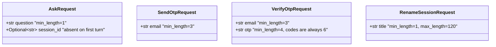
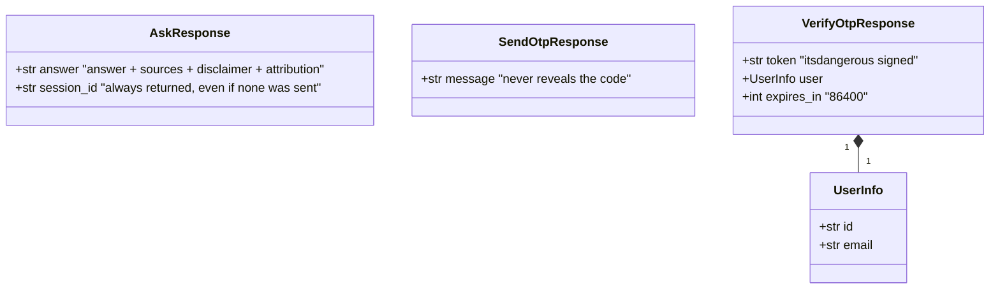
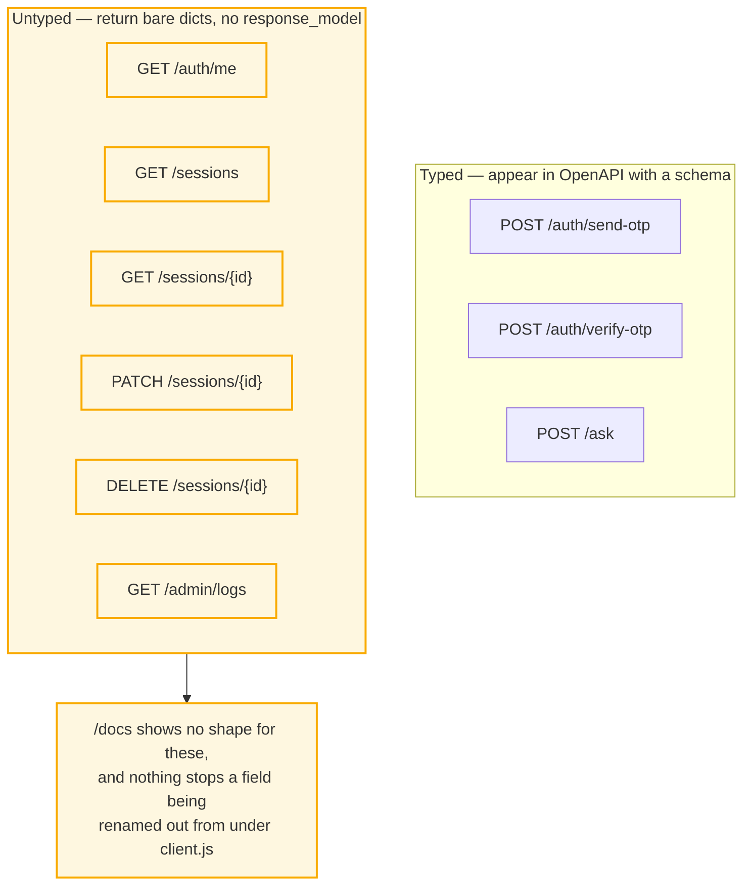

# 03 — Data Model

Every table in `legal.db`, then every shape that crosses the wire. Schema source:
[db.py](../src/db.py) `init_db()`. See [README.md](README.md) for problem IDs.

---

## §1 ER — all six tables

`otps`, `query_cache` and `query_logs` are intentionally unlinked — each for a
different reason, below.

**Why the schema looks like this**

- **`query_cache.search_query` is the primary key, and it is the *rewritten*
  query** (**P7**). "my landlord kept my deposit" and "landlord won't return
  security deposit" both normalise through `rewrite_query` to the same
  `"security deposit" ANDD tenancy ANDD refund doctypes: laws`, so they share one
  row. The LLM is doing the work an embedding model would otherwise do.
  ⚠ This is **exact string matching**, not semantic caching — the docs call it
  semantic; the code is `WHERE search_query = ?`. Do not overclaim it.
- **`query_cache` stores `llm_answer` pre-safety-layer.** The disclaimer and
  attribution are re-attached on every hit by `attach_disclaimer_and_attribution`,
  so a change to the disclaimer text takes effect immediately for cached answers
  too (**P8**). Caching the finished string would have frozen the legal text.
- **`query_logs` has no `user_id` column, by design** (**P9**). The admin
  dashboard answers "what is this costing and how fast is it" without building a
  per-citizen surveillance log.
  ⚠ But `question` is stored **raw**, and legal questions are exactly where people
  disclose their circumstances. Anonymous ≠ non-identifying. Truncating, or storing
  only the rewritten query, would keep the metrics and drop the exposure.
- **`otps.email` is a plain column, not a FK**, because an OTP is issued *before*
  the user exists — `verify_otp` creates the `users` row on first successful
  verification (**P6**). A FK would make first-time signup impossible.
- **`last_citations` is JSON in a TEXT column**, not a `citations` table. It is
  always read and written as a whole list alongside its session, never queried by
  field, so normalising it would buy nothing.
- **`created_at` on `query_cache` is written and never read.** It exists so a TTL
  can be added without a migration — see [05-state-machines.md](05-state-machines.md) §5.

### ⚠ Schema-level defects, drawn where they live

---

## §2 Wire contracts — what crosses the HTTP boundary

Pydantic models in [api.py](../src/api.py). Validation is the point: a bad body
fails at the edge with a 422 before any paid API call is made.

**Request bodies** — validated at the edge, so a bad body 422s before any paid
API call is made.

**Response bodies**

**Why these shapes**

- **`AskResponse.session_id` is always returned, even when the client sent none.**
  That is how an anonymous first turn becomes a continuable conversation: the
  server mints the id, the client stores it and echoes it back. It is the entire
  session-continuity protocol.
- **`SendOtpResponse` carries only a message.** It deliberately does not say
  whether the email belongs to an existing user, so the endpoint is not an account
  enumeration oracle.
  ⚠ It also returns success on a delivery failure path (SMTP errors are caught and
  logged inside `send_otp`), which is good for enumeration and bad for debugging.
- **`VerifyOtpRequest.otp` is `min_length=4` while codes are always 6 digits.**
  Loose validation; harmless, but it means a 4-char guess reaches the DB lookup.
- **`expires_in` is sent so the client can pre-empt expiry.** `AuthContext` stores
  `legal_auth_expires_at` and logs out locally rather than waiting for a 401.

### Endpoints without a response model

The un-modelled shapes, as `client.js` actually consumes them:

| Endpoint | Returned keys |
|---|---|
| `GET /auth/me` | `user` → the token payload `{email, user_id}` |
| `GET /sessions` | `sessions[]` → `{session_id, title, created_at, last_active_at}`, plus `limit`, `offset` |
| `GET /sessions/{id}` | `session_id`, `title`, `messages[]` → `{role, content, timestamp}`, `citations[]` |
| `PATCH /sessions/{id}` | `message`, `title` |
| `DELETE /sessions/{id}` | `message` |
| `GET /admin/logs` | `metrics` → `{total_queries, cache_hit_rate, avg_response_time_ms}`, `logs[]` → full `query_logs` rows |

⚠ Note the asymmetry: `GET /auth/me` returns `{email, user_id}` from the token,
while `VerifyOtpResponse.user` returns `{id, email}`. Same concept, two key names.
