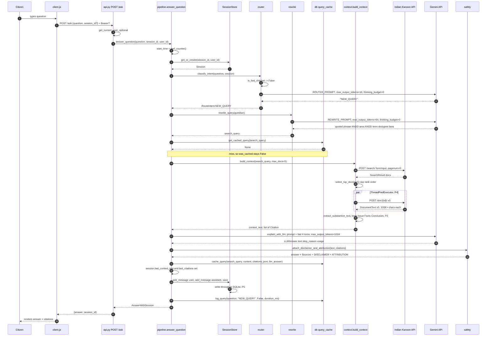
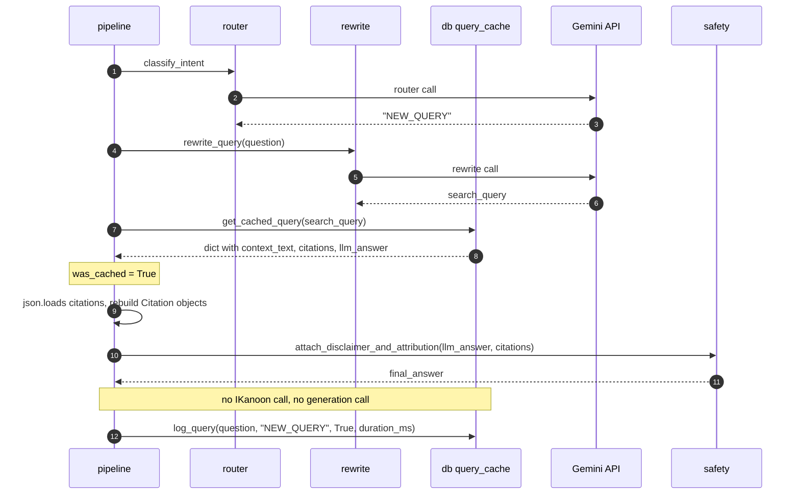
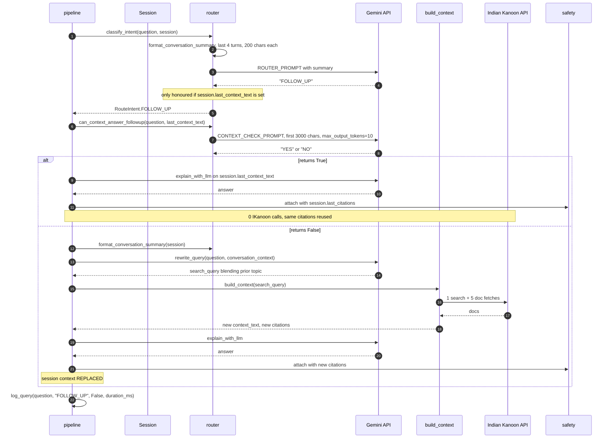
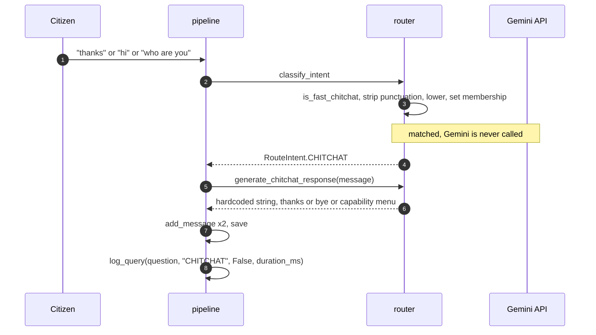
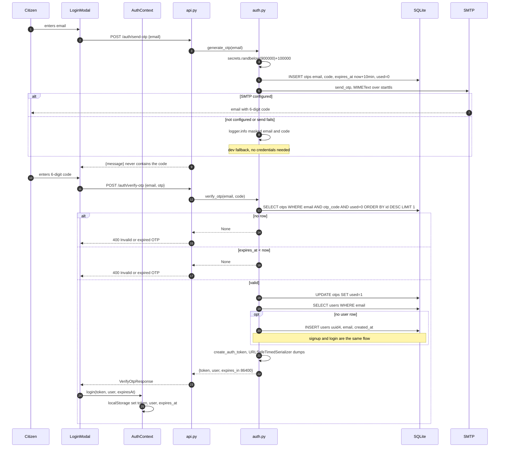
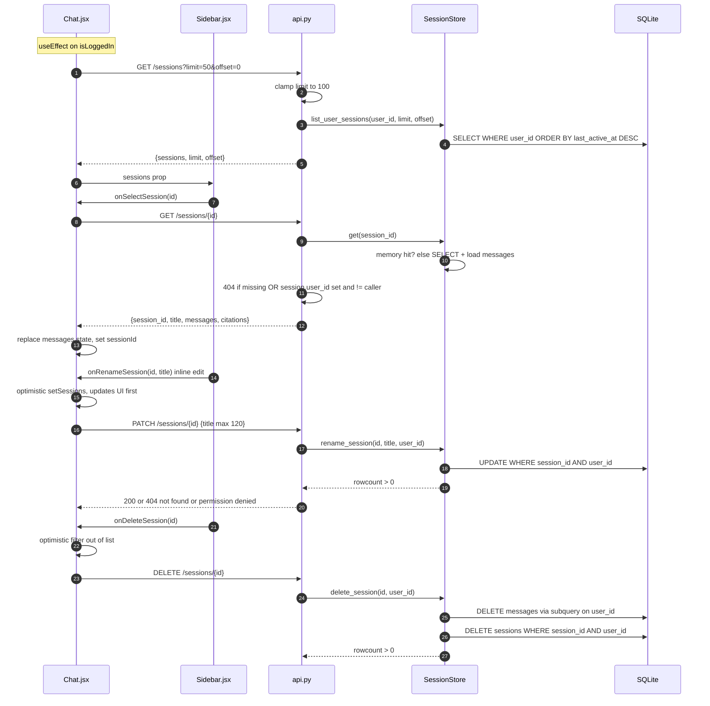
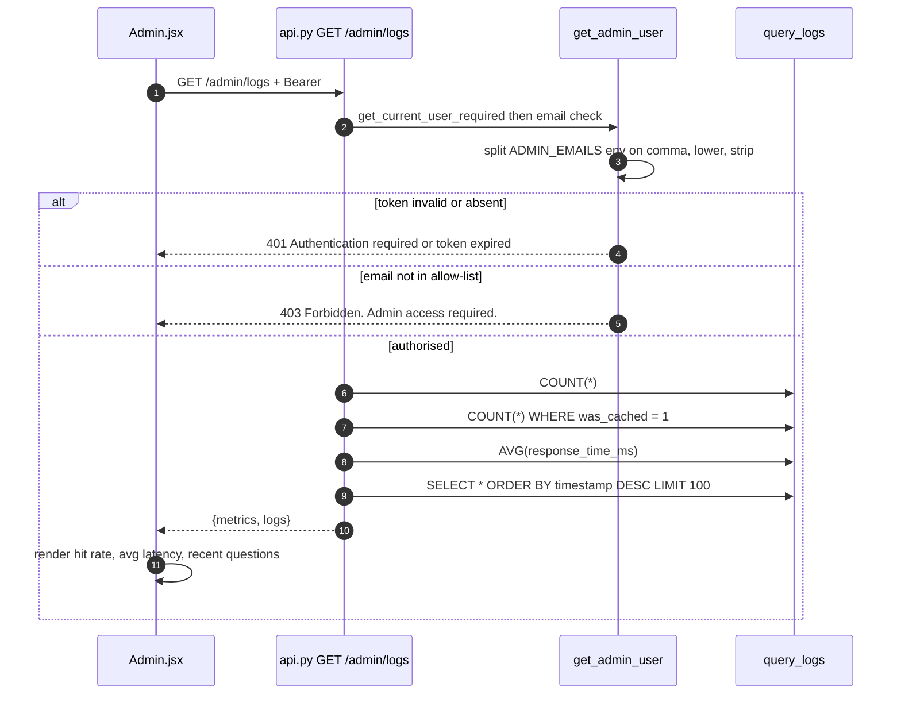

# 04 — Sequences

What happens in order, for the flows that matter. Each diagram is annotated with
its **cost**, because cost is the reason the branches exist (**P3**, **P7**).

Source of truth: [pipeline.py](../src/pipeline.py) `answer_question`,
[api.py](../src/api.py), [auth.py](../src/auth.py).

Reference prices from [p.md](../p.md) §10: one IKanoon search plus document
fetches is **₹0.50–0.90** per question.

---

## §1 NEW_QUERY, cache miss — the full-cost path

Every external call the system can make, in one request.

**Cost: 3 Gemini calls + 6 IKanoon calls (1 search + 5 docs) ≈ ₹0.50–0.90.**

**Why this order**

- **The cache check sits *after* the rewrite, not before it.** That is what makes
  the cache work across phrasings (**P7**) — the rewritten query is the
  normalisation key. ⚠ The price is that a cache *hit* still costs one Gemini call;
  the cache can never make a request free, only cheap. A cheap exact-match lookup
  on the raw question, tried first, would shortcut the repeat-verbatim case.
- **`select_top_docs` then fan-out, in that order.** Narrowing to 5 before fetching
  is the only thing keeping the paid document calls bounded.
- **Extraction happens before the prompt is built**, so the 100K-char bodies never
  reach Gemini (**P2**).
- **`log_query` is last and unconditional**, so latency includes everything above
  it. That is what makes `avg_response_time_ms` on the admin page honest.
- ⚠ **`cache_query` runs before the session is saved.** If persistence then fails,
  the answer is cached but the conversation is lost.

---

## §2 NEW_QUERY, cache hit — the cheap path

**Cost: 2 Gemini calls, 0 IKanoon calls, ₹0 in IKanoon fees.**

**Why**

The cached row deliberately stores the **pre-safety** answer, so the disclaimer and
attribution are re-attached live (**P8**). Cached answers therefore always carry the
current legal text.

⚠ **No TTL and no invalidation.** `created_at` is stored but never compared, so a
cached answer about an amended Act is served indefinitely. For a tool whose entire
justification is "the law stays current", this is the most consequential open
defect in the system. See [05-state-machines.md](05-state-machines.md) §5.

---

## §3 FOLLOW_UP — context reuse

The branch that exists purely to avoid paying twice for the same law.

**Cost: `True` → 3 Gemini, 0 IKanoon. `False` → 4 Gemini, 6 IKanoon.**

**Why**

- **The context-check is a separate one-word LLM call** (10 output tokens) guarding
  a ₹0.50–0.90 decision. Cheap gate, expensive thing gated.
- **Only the first 3000 chars are checked.** A gamble: the answer may live deeper in
  the context. It bounds the gate's own cost, and being wrong just means an
  unnecessary retrieval, never a wrong answer.
- **`FOLLOW_UP` is only honoured when `last_context_text` exists** — both in
  `classify_intent` and in `pipeline`'s branch condition. A model that says
  `FOLLOW_UP` with no context falls through to `NEW_QUERY`. Two independent guards
  for the same invariant, because the failure mode is answering from nothing.
- **On the `False` path the query is rewritten *with* conversation context**, which
  is how "what about the deadline?" becomes a query that still mentions tenancy.
- ⚠ **`was_cached` is always `False` on this branch**, and `query_cache` is never
  consulted — a follow-up that happens to match a cached query re-pays IKanoon.
- ⚠ **`log_query` records `was_cached=False` even when the `True` path made zero
  IKanoon calls**, so the admin hit-rate understates how much the router saves.
  The metric measures the cache, not the savings.

---

## §4 CHITCHAT — the zero-cost path

**Cost: 0 Gemini, 0 IKanoon, ₹0. No network I/O at all.**

**Why**

- **A 18-entry `set` beats a model call** for the highest-frequency inputs a chat
  UI receives. `FAST_CHITCHAT_PATTERNS` is checked before anything else in
  `classify_intent` (**P3**).
- **Responses are hardcoded, not generated.** The capability menu doubles as
  onboarding — it lists the four supported areas of law, so a greeting teaches the
  user what to ask. A generated reply would vary and could over-promise.
- **No disclaimer is attached on this branch**, correctly: `attach_disclaimer_and_attribution`
  is never called, because "hello" is not legal information.
- An unmatched greeting still falls through to the Gemini router, which classifies
  it `CHITCHAT` — so the fast path is an optimisation, not the only guard.

---

## §5 OTP login — passwordless (P6)

**Why**

- **`ORDER BY id DESC LIMIT 1`** means requesting a new code supersedes the old one
  in practice, without deleting rows — the newest matching unused code wins.
- **The same 400 message for "no row" and "expired"** so the endpoint does not
  distinguish a wrong code from a stale one.
- **`used=1` before the user lookup**, inside one `with conn:` transaction, so a
  code cannot be replayed even if user creation fails.
- **Signup has no separate flow.** First successful verification creates the user.
  There is no password column, no reset path, no email-confirmation step — the OTP
  *is* the confirmation (**P6**).
- **Emails are masked in logs** (`_mask_email` → `pi***@gmail.com`), but the dev
  fallback logs the **code in cleartext** — acceptable locally, catastrophic if a
  production host ever runs without SMTP configured.
- ⚠ **No rate limit and no attempt counter, on either endpoint.** `send-otp` can be
  used to mail-bomb an address, and `verify-otp` accepts unlimited guesses against a
  6-digit code for 10 minutes. This is the highest-severity gap in the system. The
  fix is an attempt column plus per-email throttling.

---

## §6 Conversation management

Requires auth on every call — `get_current_user_required`.

**Why**

- **Ownership is enforced in the SQL `WHERE`, not in a Python `if`.** `rename_session`
  and `delete_session` both filter on `user_id` inside the statement and return
  `rowcount > 0`, so a mismatched owner is indistinguishable from a missing row —
  one code path, no IDOR gap, and the 404 leaks nothing.
- **Messages are deleted before sessions**, via a subquery that re-checks ownership,
  because declared FKs are not enforced and there is no `ON DELETE CASCADE`
  (see [03-data-model.md](03-data-model.md) §1).
- **Rename and delete are optimistic in the UI**, which is why they feel instant.
  ⚠ Neither rolls back the local state if the request fails.
- ⚠ **`GET /sessions/{id}` allows an anonymous session to be read by any
  authenticated user**: the guard is `session.user_id and session.user_id != caller`,
  so when `user_id` is `NULL` the check short-circuits and access is granted. Guessing
  a uuid4 is impractical, but the rule should be "owner, or nobody".
- ⚠ **`rename_session` updates the in-memory copy before the DB**, and does not
  revert it if `rowcount` is 0.

---

## §7 Admin metrics (P9)

**Why**

- **Admin is an env-var allow-list, not a DB role.** No `is_admin` column, no role
  table — for a two-person non-profit tool, `ADMIN_EMAILS` is the whole
  authorisation model, and it cannot be escalated by writing to the database.
- **Three aggregates computed in SQLite, not in Python**, so the 100-row log slice
  and the metrics are independent — metrics stay correct as the table grows.
- ⚠ The dependency ladder means a **non-admin gets 403 while a stranger gets 401**,
  which confirms to an authenticated user that the endpoint exists. Acceptable here.
- ⚠ `metrics` are computed over **all time**, with no date filter, so the hit rate
  drifts toward a lifetime average and stops reflecting recent behaviour.
