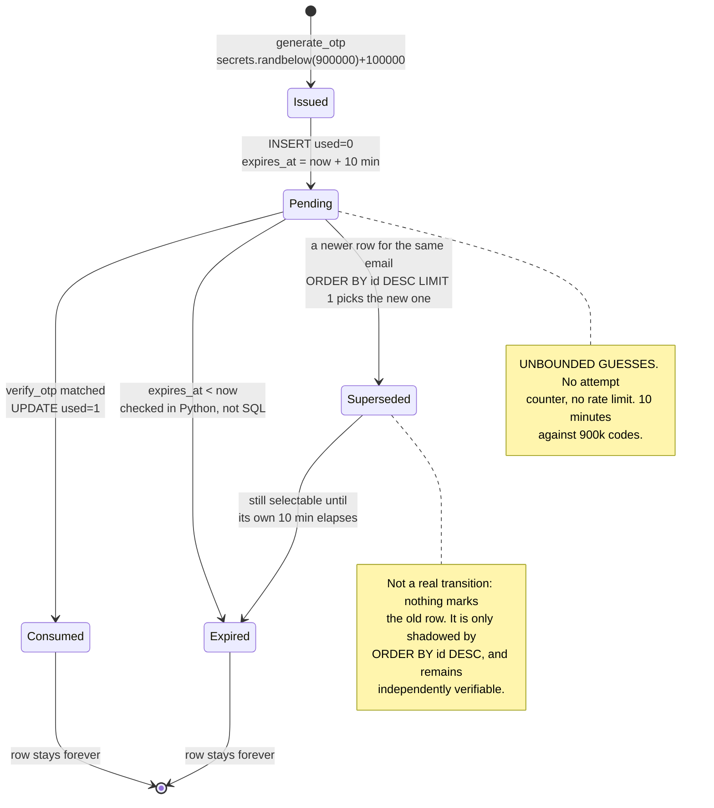
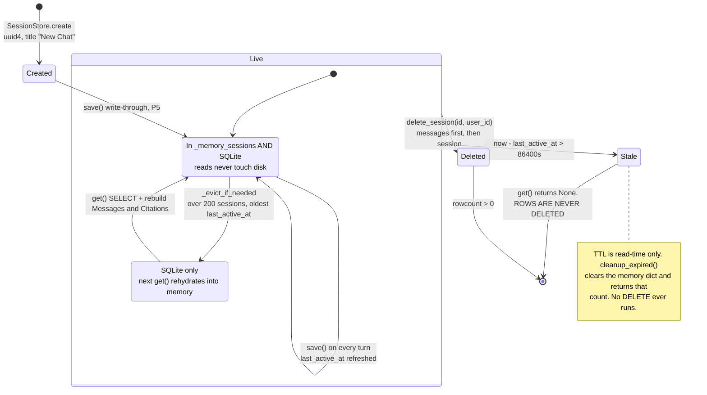
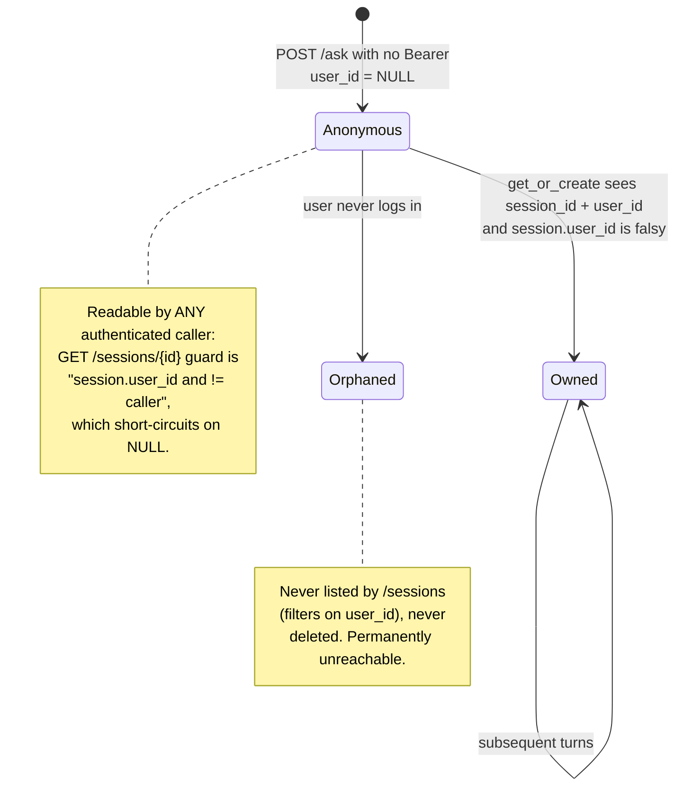
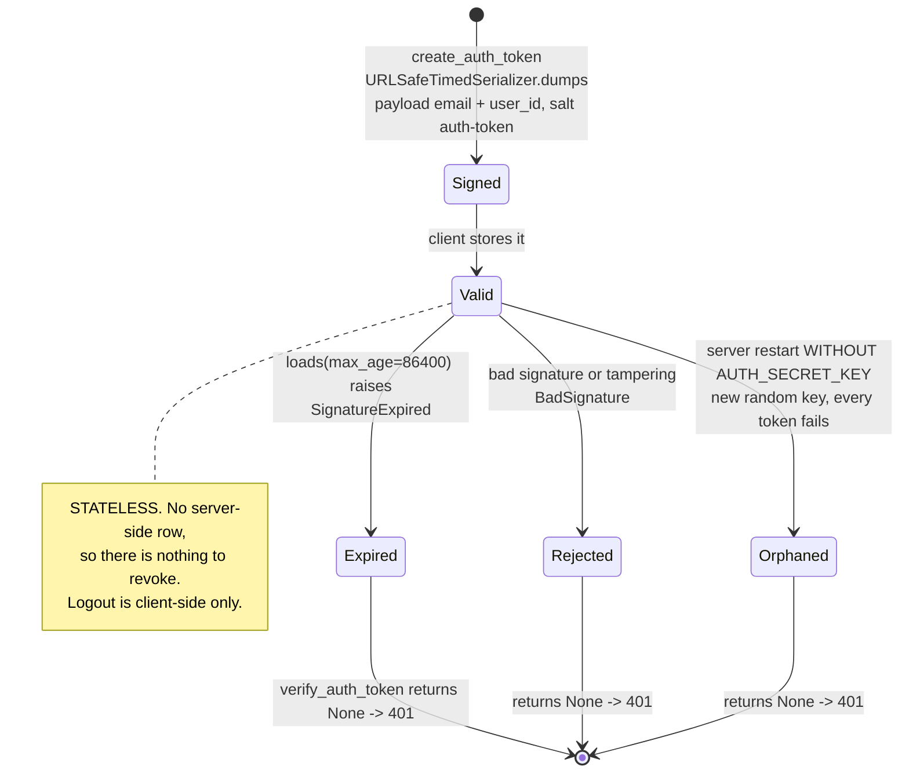
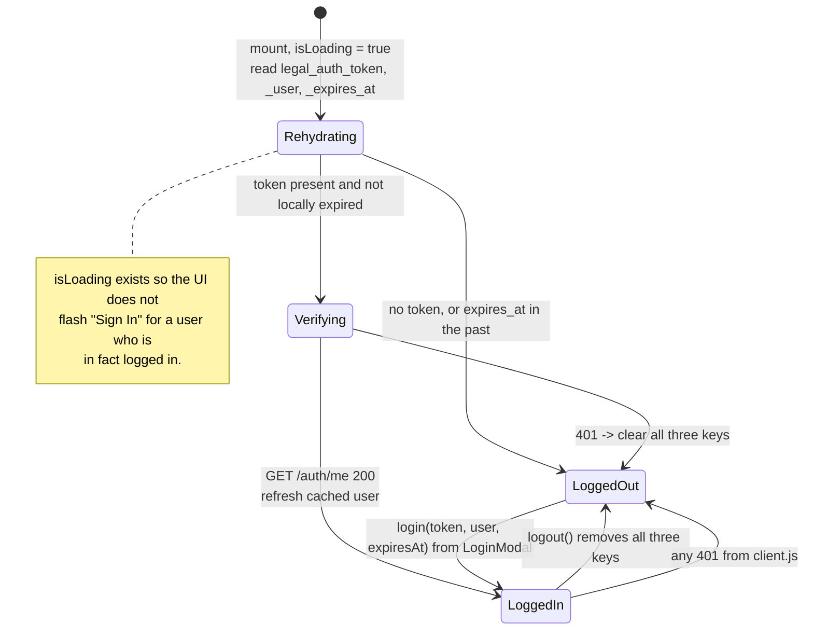
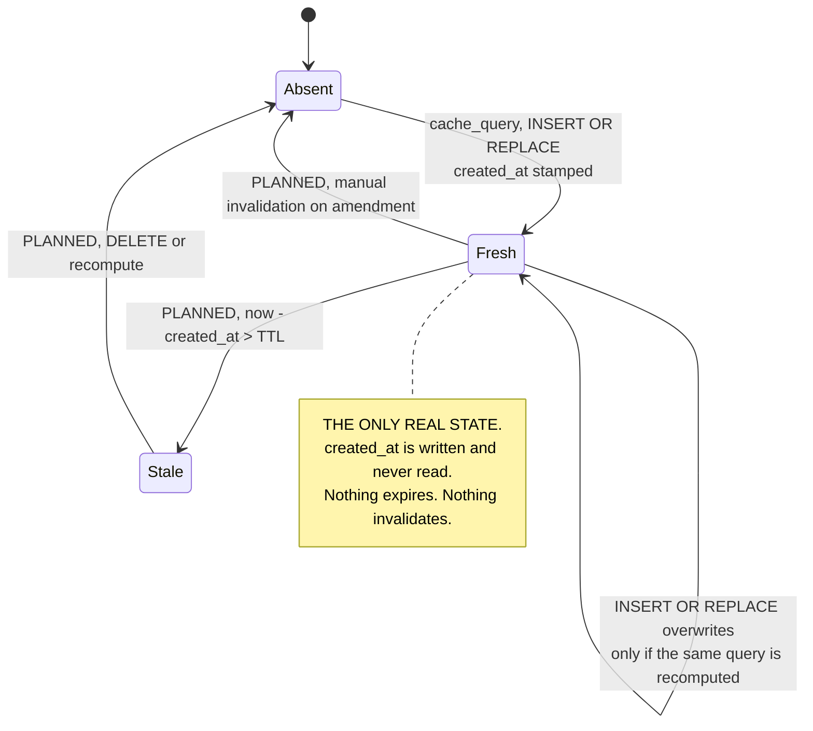
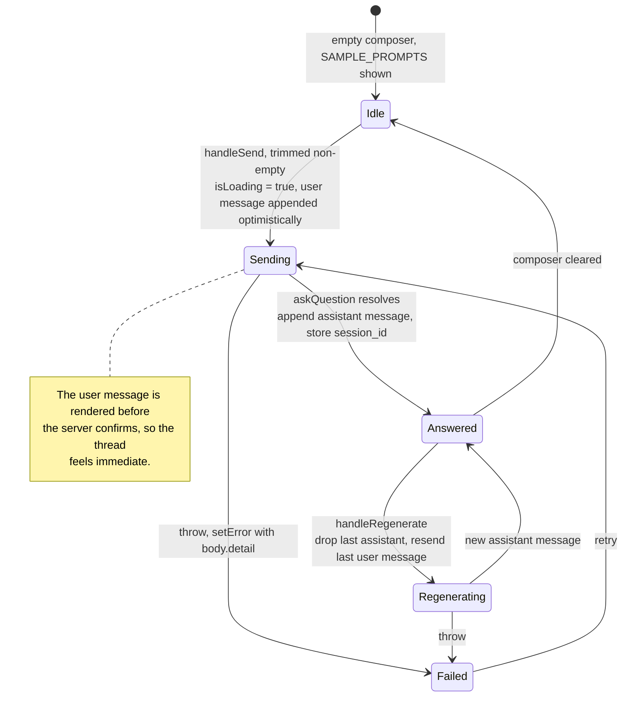

# 05 — State Machines

Every entity in the system whose status has **more than two values**. Two-valued
flags are omitted; they are documented by the schema in
[03-data-model.md](03-data-model.md).

---

## §1 OTP lifecycle

Backed by `otps.used` plus `otps.expires_at` — two columns encoding four states.



**Why it looks like this**

- **`used=1` is set inside the same `with conn:` block as the user lookup**, so a
  code is burned atomically and cannot be replayed even if signup then fails.
- **Expiry is compared in Python** (`row["expires_at"] < now_iso`) rather than in the
  `WHERE` clause. ISO-8601 UTC strings sort lexicographically, so either works;
  doing it in Python is what lets the code return the same `None` for both wrong and
  expired, keeping the two indistinguishable to a caller (**P6**).
- **Nothing reaps `Consumed` or `Expired` rows.** `otps` grows forever.

**⚠ Defects visible in this machine**

1. `Pending` has no attempt ceiling — the single most exploitable gap in the system.
2. `Superseded` is not a real state. Requesting a new code does **not** invalidate
   the previous one; both stay verifiable until each expires. Widening the attack
   window is the opposite of what a resend should do.
3. `otp_code` is plaintext at rest, so any DB read hands over every `Pending` code.

**Fix:** add `attempts INTEGER DEFAULT 0`, cap it, throttle `send-otp` per email,
`UPDATE otps SET used=1 WHERE email=? AND used=0` before inserting a new code, and
store a hash instead of the code.

---

## §2 Session lifecycle

Two storage tiers and a TTL, so "does this session exist?" has four answers.



**Why it looks like this**

- **Write-through, not write-back** (**P5**). Step 5 shipped memory-only and lost
  everything on restart; SQLite became the record while the dict stayed as the read
  path. `save()` writes both, every turn.
- **Eviction is LRU by `last_active_at`, capped at 200.** Bounds memory without a
  background thread — eviction happens inline on `save()`.
- **Demotion `Hot → Warm` is lossless**, which is the whole point of the tier: an
  evicted session rehydrates on next `get()`, including its `last_context_text`, so
  a follow-up after eviction still costs ₹0 in IKanoon fees (**P3**).
- **TTL is checked in `get()` in both tiers**, so an expired session is invisible
  even though its row is intact.

**⚠** `Stale` is a leak, not a state: rows accumulate forever, holding
`last_context_text` — retrieved legal text — for conversations nobody can reach.
`cleanup_expired()` reads as a reaper and is not one. And because the TTL is
read-time, a session stale for a year is unreachable but never purged.

### §2b Anonymous-to-owned transition



**Why:** a citizen can ask a question without an account, then sign in and keep the
conversation — the adoption happens in `get_or_create`, which back-fills `user_id`
and saves. That is a real product decision: the tool must work for someone who will
not create an account (**P6**).

**⚠** Adoption is one-way and unguarded: whoever presents the session id first
claims it. Combined with the `NULL` short-circuit above, an anonymous session id is
a bearer token with no expiry beyond the 24 h TTL.

---

## §3 Auth token



**Why it looks like this**

- **Stateless signed tokens, not session rows** (**P6**). No lookup per request, and
  expiry is enforced by `max_age` at verification. That is what lets three FastAPI
  dependencies (`optional`, `required`, `admin`) layer with zero DB cost.
- **All failure modes collapse to `None`.** `verify_auth_token` catches bare
  `Exception`, so expired, tampered and orphaned are one 401 — no oracle telling an
  attacker which it was.
- **`salt="auth-token"`** scopes the signature, so a token could never be replayed
  against a different serializer purpose added later.

**⚠** Two consequences of statelessness worth naming out loud:

1. **No revocation.** A stolen token is valid for its full 24 h. Logout clears
   `localStorage` and nothing else.
2. **`Orphaned` is reachable by accident.** Without `AUTH_SECRET_KEY`, `auth.py`
   generates an ephemeral key and logs a warning. Every restart logs everyone out,
   and multiple workers would each sign with a different key.

---

## §4 Frontend auth state (AuthContext)

Three fields — `user`, `token`, `isLoading` — encoding four states.



**Why:** `legal_auth_expires_at` is stored specifically so the client can decide it
is logged out **without** a network round trip — the local check runs first, and
`/auth/me` only confirms a token that still looks live. Server truth still wins.

**⚠** The token lives in `localStorage`, so any XSS reads it; and `/admin` is not
route-guarded, so a non-admin reaching it sees the 403 error text rather than a
redirect.

---

## §5 Cache entry — the machine that is missing states

Drawn to show the **absence**. Solid = built. Dashed = `PLANNED`, not implemented.



**Why this is the most consequential gap in the system**

The project's entire justification for RAG over fine-tuning is that *the law stays
current* ([p.md](../p.md) §1) — statutes get amended, BNS/BNSS/BSA replaced older
codes. An unbounded cache **reintroduces exactly the staleness that RAG was chosen
to avoid**. It is not an optimisation with a minor cost; it contradicts the premise.

`created_at` already exists, so the smallest honest fix is one clause:

```sql
SELECT ... FROM query_cache
WHERE search_query = ? AND created_at > ?   -- now - TTL
```

**⚠** Note also that a `Fresh` row is only refreshed when the same query is
recomputed — and it never will be, because the lookup succeeds first. Without a TTL
the row is not just long-lived, it is **immortal by construction**.

---

## §6 Chat send state (Chat.jsx)



**Why:** the optimistic append is what makes the UI feel like a chat rather than a
form. `session_id` from the **first** response is what turns a one-shot answer into a
conversation (see [04-sequences.md](04-sequences.md) §1).

**⚠** `Regenerate` re-sends the same question on the **same session**, so
`classify_intent` now sees the prior turns and may route it `FOLLOW_UP` — a
regenerated answer can come from reused context rather than a fresh retrieval. And
because the dropped assistant message was already persisted by `SessionStore.save`,
the `messages` table keeps both the discarded and the regenerated reply, while the
UI shows only the new one.
