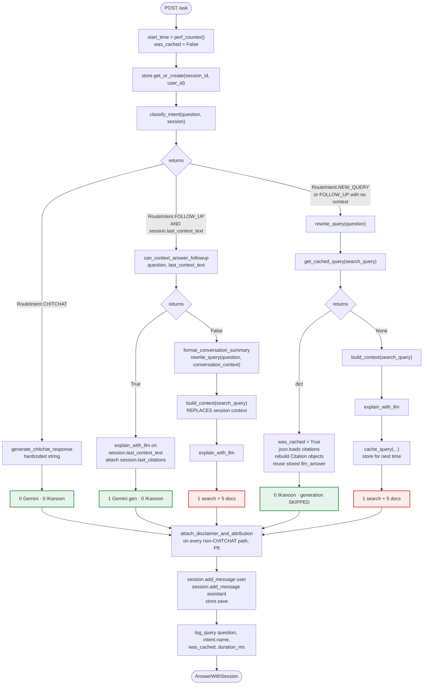
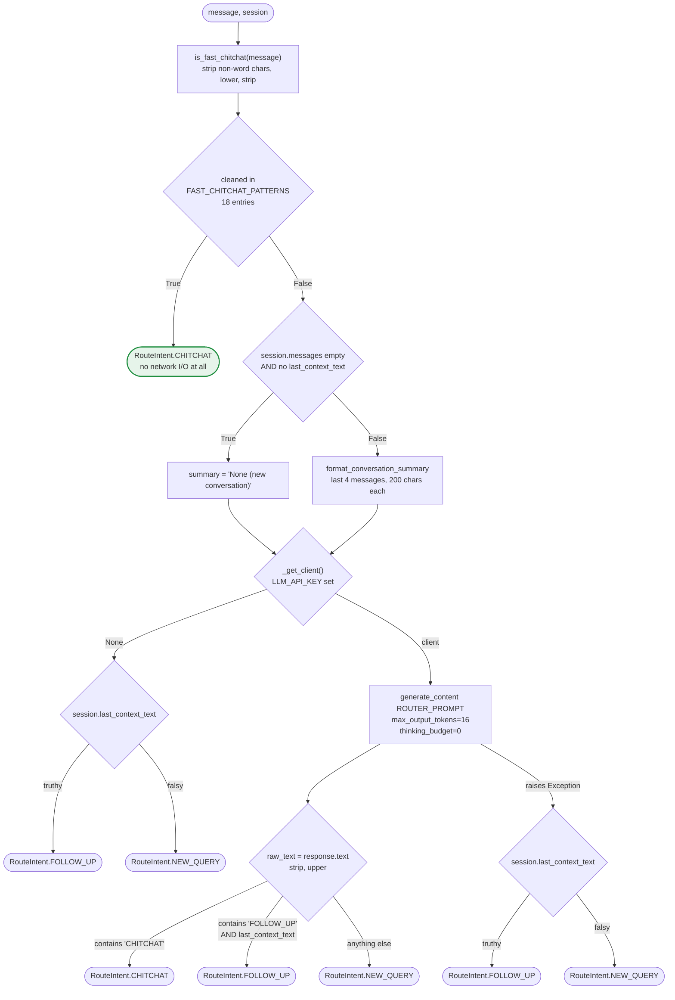
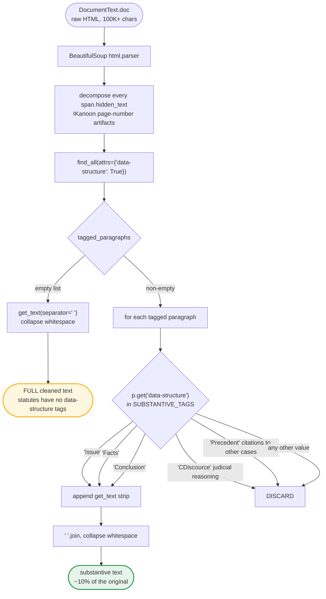
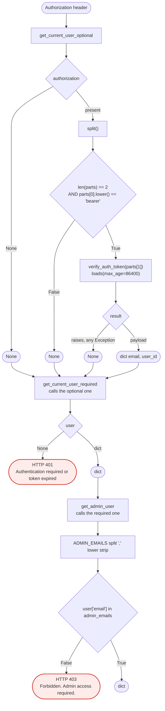

# 06 — Activity

The decisions, branch by branch. **Every branch label is the literal value the code
returns or tests** — no paraphrases.

---

## §1 `answer_question` — the cost decision tree

The one function where all three branches meet ([pipeline.py](../src/pipeline.py)).
Colour is money: green = ₹0 in IKanoon fees, red = ₹0.50–0.90.

**Reading the tree**

- **Three of five leaves cost ₹0 in IKanoon fees.** That is the router's entire
  justification (**P3**) — and the shape makes it auditable at a glance.
- **`CHITCHAT` skips the safety layer**, correctly: no legal information, no
  disclaimer.
- **`FOLLOW_UP` never consults `query_cache`.** ⚠ A follow-up whose rewritten query
  already exists in cache still re-pays IKanoon on the `False` branch.
- **Only the `None` branch writes to the cache.** The `dict` branch cannot refresh
  the row, which is why a cached row is immortal
  ([05-state-machines.md](05-state-machines.md) §5).
- **`was_cached` only ever becomes `True` on the `dict` branch**, so the admin
  hit-rate (**P9**) ignores the two router branches that saved the most money. The
  metric measures the cache, not the savings.

---

## §2 `classify_intent` — cheap guards before expensive ones

**Why the guards are ordered this way**

- **Set membership before a model call.** The highest-frequency inputs to any chat
  UI are greetings; answering them from a `set` costs nothing (**P3**).
- **`"contains"`, not equality.** `"FOLLOW_UP" in raw_text` tolerates a model that
  adds punctuation or a newline. With 16 output tokens there is no room for prose, so
  substring matching is safe and strictly more robust.
- **`FOLLOW_UP` is double-guarded** — the model must say it *and* `last_context_text`
  must exist. Answering a follow-up with no context is the one failure mode worth
  two checks.
- **Every failure path degrades toward doing more work, never toward answering from
  nothing.** No API key and no exception both fall to `NEW_QUERY` unless context
  exists. Failures cost money, not correctness.
- ⚠ `except Exception` swallows the cause. A misconfigured key looks identical to a
  transient 503, and nothing is logged.

---

## §3 `extract_substantive_text` — which paragraphs reach the LLM (P2)

The 90% token saving, as a decision.

**Why this is the chunking strategy**

There is **no fixed-size chunking, no overlap, no embeddings and no vector store**.
The retrieval unit is a whole document, filtered structurally. That works because:

- **IKanoon already labels each paragraph's role**, so semantic segmentation comes
  free — no embedding model has to guess boundaries.
- **Ranking happens upstream.** IKanoon's keyword search picks the documents, so
  there is nothing to re-score locally.
- **Five filtered documents fit Gemini's context window**, so sub-document splitting
  buys nothing.
- **Dropping `CDiscource` and `Precedent` is a product decision**, not just a cost
  one: a citizen needs the outcome in plain language, not the court's reasoning chain.

**⚠ Where it is weak**

1. **The fallback is unbounded.** No `data-structure` tags means the full cleaned
   text, and nothing in `build_context` or `build_prompt` caps length — so a
   statute-heavy result set can spike tokens and latency. The single highest-value
   fix: cap per-document and total context length.
2. **No passage-level relevance.** A document is included whole even if one paragraph
   matters. Precision rests entirely on `rewrite_query` (**P1**) and IKanoon's rank.
3. **Silent degradation.** If IKanoon changes its markup, every document takes the
   fallback path and token cost quietly returns to 100%. Nothing logs it.
4. **`clean_document_html` is dead code** — defined, tested, never called by
   `build_context`.

---

## §4 Auth dependency ladder

Three FastAPI dependencies, each building on the last. The ladder is why route
protection is one parameter and not a middleware.

**Which route uses which**

| Dependency | Routes | Why |
|---|---|---|
| `get_current_user_optional` | `POST /ask` | The tool must work with no account (**P6**). `user_id` is `None` and the session is anonymous. |
| `get_current_user_required` | `/auth/me`, all `/sessions*` | Chat history is per-user; there is nothing to return without an identity. |
| `get_admin_user` | `GET /admin/logs` | Env-var allow-list, not a DB role — cannot be escalated by writing to the database (**P9**). |

**Why a ladder rather than middleware:** `/ask` needs to *know* whether a caller is
authenticated without *requiring* it. Middleware would have to either reject or
ignore; a dependency returns `None` and lets the handler decide. That single
distinction is what makes anonymous-then-adopt possible
([05-state-machines.md](05-state-machines.md) §2b).

**⚠** `verify_auth_token` catches bare `Exception`, so a malformed token, an expired
one and a tampered one are indistinguishable — good for attackers, bad for
debugging, and nothing is logged.
